# ApiDoc UI

[](https://github.com/erikwang2013/apidoc-ui/releases)


基于 Vue3 + TypeScript 的 API 接口文档前端，配合 [apidoc-php](https://github.com/erikwang2013/apidoc-php)、[apidoc-rust](https://github.com/erikwang2013/apidoc-rust)、[apidoc-go](https://github.com/erikwang2013/apidoc-go) 后端使用。构建产物为纯静态文件，不依赖任何后端运行环境。

<p align="center">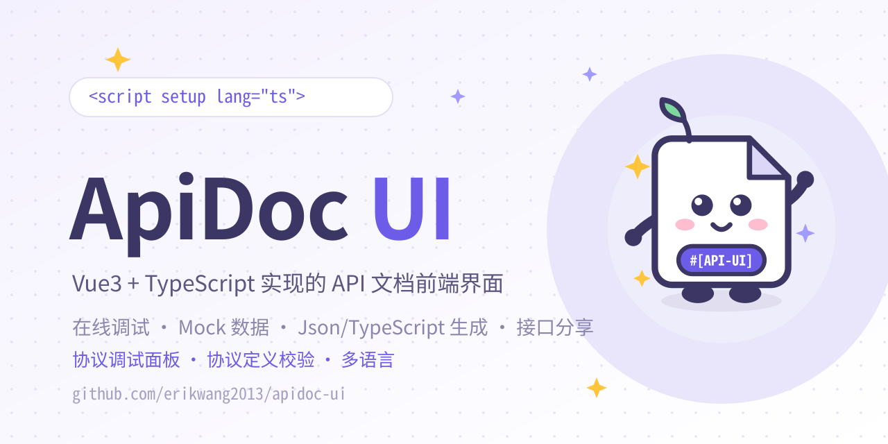</p>

## 项目介绍

Apidoc是一套通过解析 PHP/Rust/Go 注解自动生成 API 接口文档的解决方案：

- 服务端为 PHP/Rust/Go，接口代码中写几句注解即可自动产出文档数据；
- 本项目（ApiDoc UI）即该方案的**前端界面**：负责拉取接口配置与文档数据，以应用 / 版本 / 分组的形式展示接口文档，并提供在线调试、任意协议调试面板、接口分享、Swagger/Postman/AsyncAPI 导出、缓存管理等一系列开箱功能。

项目来源于 [HGthecode/apidoc-php](https://github.com/HGthecode/apidoc-php) 生态，原作者为 HG-CODE，本仓库为独立维护的 UI 前端仓库。

## 项目说明

- **纯静态前端**：构建产物（`apidoc/` 目录）无任何服务端语言依赖，可部署到任意静态 Web 服务器，或后端项目的 public 目录下直接访问；
- **运行时配置**：后端地址、接口前缀等通过与 `index.html` 同级的 `config.js`（`window.apidocFeConfig`）配置，修改后刷新即生效，**无需重新打包**；
- **前后端分工**：三套后端（apidoc-php / apidoc-go / apidoc-rust）各自解析注解并提供 UIC-1 文档、调试与鉴权接口；前端启动时按 `/ui/v1/capabilities` 自动适配，不按后端类型写死分支。替换或升级任一端均可独立进行；
- **多应用支持**：一套后端可管理多个应用 / 版本，前端通过 `appKey` 切换（见下方配置说明）。

## 功能特性

- 一套构建适配 PHP / Go / Rust：按 UIC-1 capabilities 显示能力入口，未升级的 PHP 后端自动回退 legacy 适配器
- 应用 / 版本 / 分组结构展示接口与文档，支持全部展开收起
- 接口详情多视图：字段表格、Json、TypeScript、协议定义、在线调试
- 在线调试：请求前 / 响应后事件、全局参数（Header / Query / Body）、文件上传、Mock 规则扩展
- 全协议调试：HTTP/WebSocket/SSE 浏览器直连；gRPC、MQTT、Kafka、AMQP、DNP3、IEC 104、BACnet、OPC UA 等 40+ 协议经后端中继，支持单次与流式消息
- 协议定义：解析 OpenAPI、AsyncAPI、GraphQL、Proto、WSDL、EDMX、JSON Schema、JSON-RPC、XML-RPC 共 9 种格式，展示消息与校验结果
- 接口分享、Swagger/OpenAPI、Postman、AsyncAPI 导出，缓存管理（PHP/Go 运行时，Rust 构建期）
- 声明式生成器与代码模板（按后端能力显示；legacy PHP 生成器保留副作用提示）
- 多语言、多 Host 切换，菜单自定义宽度，访问密码授权
- 内置 md5、setToken 等调试事件扩展点，可自行注册

## 后端与能力矩阵

UI 启动时请求 `GET {API_PREFIX}/ui/v1/capabilities`，按后端如实声明的能力显示入口；未实现的能力会隐藏，而不是按“某后端应该有”推断。未升级的 PHP 后端回退 legacy 适配器。

| 能力           | PHP                          | Go                                | Rust                               |
| -------------- | ---------------------------- | --------------------------------- | ---------------------------------- |
| UIC-1 contract | 1.0                          | 1.0                               | 1.0                                |
| 协议调试       | 中继：单次 + 流式            | 中继：单次 + 流式（按编译 tag）   | 中继：单次（按编译 feature）       |
| 9 种协议定义   | 支持                         | 支持                              | 支持                               |
| 分享           | 链接 + 记录                  | 链接 + 记录 + 动作                | 链接 + 记录                        |
| 生成器         | 表单 + 模板（无副作用）      | 表单 + 模板（无副作用）           | 仅模板                             |
| 缓存           | 运行时管理                   | 运行时管理                        | 构建期物化，改文档后重新构建       |
| 静态 UI        | 部署到站点 UI 目录           | `Config.UIPath`                   | `ui: UiMode::Vue` + `ui_path`      |

> Go 的协议中继需对应编译 tag，Rust 需对应 feature，PHP 在缺少扩展时降级（如 curl 无 HTTP/3 则不提供 HTTP/3）。能力与配置细节见 [UIC-1 升级指南](docs/superpowers/guides/2026-10-26-uic1-upgrade.md)。

## 技术栈

Vue 3.5 · TypeScript · Vite 6 · Ant Design Vue 3 · Pinia · Monaco Editor

## 快速开始

要求 Node.js ≥ 18。

```bash
npm ci          # 安装依赖（锁定版本，建议 ci）
npm run dev     # 本地开发，默认 http://localhost:6969（端口见 config/constant.ts 的 VITE_PORT）
```

## 打包与部署

```bash
npm run build   # vue-tsc 类型检查 + 构建，产物输出到 apidoc/ 目录
```

构建产物使用相对路径，可直接整体复制到任意静态 Web 服务器或后端项目的 public 目录下。

部署时注意：

1. `config.js` 必须与 `index.html` 同目录存放（产物中已自动携带）；
2. 替换线上旧文件前先清空旧目录：新版 `index.html` 不再引用旧版哈希资源（`assets/*`、`utils/*`），残留无用且易被缓存；
3. 改完 `config.js` 后强制刷新一次（Ctrl+F5）。`config.js?v=<版本号>` 为缓存戳，来自 package.json 的 version，发布新版即可自动失效旧缓存。

## 打包共享 UI（UIC-1）

PHP / Go / Rust 三端共用同一份构建。发布时使用打包脚本生成带版本清单的包：

```bash
npm run package:ui                        # 构建并输出 dist/uic1-ui/
npm run package:ui -- --dest /srv/apidoc  # 额外复制到目标目录（可重复）
SKIP_BUILD=1 npm run package:ui           # 复用 apidoc/ 现有产物
npm run check:package-ui                  # 自检：重复打包哈希一致且与复算一致
```

目标目录必须已存在且为空，或包含上一次 `uic1-ui` 包（`manifest.json`）；脚本不会创建目录，也不会覆盖其他非空目录。复制只覆盖、不删除旧文件，升级前先清空旧目录。脚本要求 bash ≥ 4.4 与 GNU coreutils（`sha256sum`、`sort -z`），macOS 需安装 GNU coreutils。

`dist/uic1-ui/manifest.json` 记录 `version`、`builtAt`、`gitCommit` 与内容 `sha256`；`builtAt` 是打包时间，`SKIP_BUILD=1` 时 `gitCommit` 不保证是产物构建提交（脚本会校验构建版本与 `package.json` 一致）。同一份包部署到三端后 `sha256` 应保持一致。升级步骤、后端配置（`BACKEND`、Rust `ui`/`ui_path`、Go `UIPath`）、版本矩阵与回滚见 [UIC-1 升级指南](docs/superpowers/guides/2026-10-26-uic1-upgrade.md)。

发布流程：同步更新 `package.json` / `package-lock.json` 与根目录 `VERSION`，推送到 `main` 后 `.github/workflows/release.yml` 会读取 `VERSION`，在 `v<版本>` tag 不存在时创建 tag 和 GitHub Release；也可在 Actions 中手动触发。

## 配置说明

### 后端地址（config.js）

运行时配置，与 `index.html` 同级，修改后刷新即生效，无需重新打包：

```js
window.apidocFeConfig = {
  HTTP: {
    HOSTS: [{ title: 'prod', host: 'https://api.example.com' }], // 后端地址列表，可多个切换；留空 [] 则请求同源
    API_PREFIX: '/apidoc', // 请求前缀，注释掉时默认 "/apidoc"
    TIMEOUT: 30000,
    WITHCREDENTIALS: false,
  },
}
```

### appKey（多应用）

同一套后端可挂多个应用，前端按以下优先级选择：

1. URL 参数 `?appKey=xxx`
2. 后端 `getConfig` 返回的应用列表第一个
3. 侧边栏应用选择器手动切换

授权 token 按 appKey 分别缓存（`CACHE.PREFIX` + appKey），切换应用互不影响。

### 其他常用项（同文件）

| 配置                     | 说明                                            |
| ------------------------ | ----------------------------------------------- |
| `BACKEND`                | 后端类型覆盖：`auto` / `php` / `go` / `rust`（默认 `auto`） |
| `TITLE`                  | 页面标题                                        |
| `CACHE.PREFIX`           | 本地缓存键前缀                                  |
| `MENU.WIDTH` / `SHOWURL` | 菜单宽度 / 是否显示接口 URL                     |
| `METHOD_COLOR`           | GET / POST / PUT / DELETE 等请求类型颜色        |
| `API_DETAIL_TABS`        | 接口详情页视图顺序（table / json / ts / protocol / debug） |
| `DEBUG_EVENTS`           | 调试事件扩展（内置 md5、setToken 示例）         |
| `LANG`                   | 界面文案，可增补语言包                          |

### 构建环境变量（.env）

| 变量                  | 说明                                               |
| --------------------- | -------------------------------------------------- |
| `VITE_APP_TITLE`      | 应用标题                                           |
| `VITE_APP_DEBUG_TOOL` | 移动端调试工具：`eruda` / `vconsole`，留空关闭     |
| `VITE_DROP_CONSOLE`   | 是否在构建产物中剔除 console（config/constant.ts） |
| `VITE_BUILD_COMPRESS` | 产物压缩：默认 `gzip,brotli`，可设 `gzip` / `none` |

## 目录结构

```text
apidoc/                # 构建产物（npm run build 生成，已 gitignore）
config/vite/           # vite 插件与构建配置
public/                # 静态资源入口（config.js 等，构建时拷入产物）
scripts/               # UIC-1 打包与自检脚本
src/                   # 源码（布局、视图、store、api、工具）
types/                 # 全局类型声明
VERSION                # 发布版本（release workflow 读取）
```

## 相关项目

- 后端 / 注解解析引擎（本项目的来源）：[HGthecode/apidoc-php](https://github.com/HGthecode/apidoc-php)
- Go 后端：[erikwang2013/apidoc-go](https://github.com/erikwang2013/apidoc-go)
- Rust 后端：[erikwang2013/apidoc-rust](https://github.com/erikwang2013/apidoc-rust)
- composer 扩展包：[hg/apidoc](https://packagist.org/packages/hg/apidoc)

<!-- pet-expressions:start -->
## 项目宠物表情形态 · Apidoc UI

<table align="center">
<tr><td align="center"><br><b>笑</b><br><code>:emoji-smile:</code></td><td align="center"><br><b>欢乐</b><br><code>:emoji-joy:</code></td><td align="center"><br><b>哭</b><br><code>:emoji-cry:</code></td><td align="center"><br><b>沮丧</b><br><code>:emoji-depressed:</code></td><td align="center"><br><b>惊恐</b><br><code>:emoji-terrified:</code></td><td align="center"><br><b>愤怒</b><br><code>:emoji-angry:</code></td></tr>
<tr><td align="center"><br><b>撒娇</b><br><code>:emoji-coquettish:</code></td><td align="center"><br><b>卖萌</b><br><code>:emoji-cute:</code></td><td align="center"><br><b>讨好</b><br><code>:emoji-pleasing:</code></td><td align="center"><br><b>敲打</b><br><code>:emoji-knocking:</code></td><td align="center"><br><b>捂脸</b><br><code>:emoji-facepalm:</code></td><td align="center"><br><b>吐舌头</b><br><code>:emoji-tongue:</code></td></tr>
</table>

> 12 种彩色动态形态：笑 / 欢乐 / 哭 / 沮丧 / 惊恐 / 愤怒 / 撒娇 / 卖萌 / 讨好 / 敲打 / 捂脸 / 吐舌头。每个 SVG 自带表情、情绪特效与整体动效，并遵循 `prefers-reduced-motion`。
<!-- pet-expressions:end -->

<!-- assets-license:start -->
## 视觉资产授权 / Visual Assets License

本项目的项目宠物、图片、图标、表情（包括 `docs/pet-expressions/` 等目录下的
SVG / PNG）**不是开源资产**，版权归作者所有。未经书面许可不得复制、修改、再分发或
用于商业用途；商业使用需取得商业授权，联系 **erik@erik.xyz**。详见
[ASSETS-LICENSE.md](ASSETS-LICENSE.md)。

> 代码部分仍遵循仓库原有 `LICENSE`；第三方素材（如明确标注的 Go Gopher 等）仍遵循其原许可证。
<!-- assets-license:end -->

